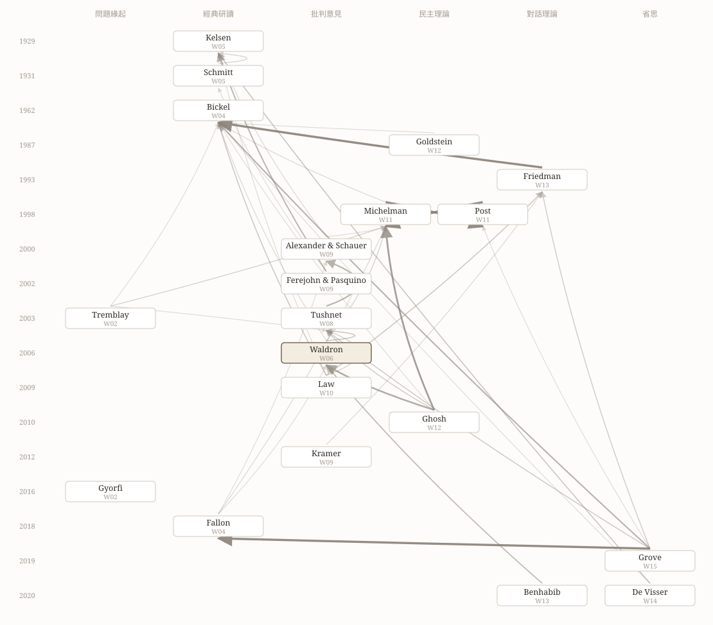

# 文獻之間的引用關係

本學期二十篇指定文獻的作者姓氏，在彼此的正文與註釋裡各出現幾次，據以看每一篇的上下游。

圖 1　115-1 指定文獻的引用關係。橫向為課綱的六個分段，縱向為出版年由舊而新；箭頭自引用者
指向被引者，線的粗細依出現次數。各篇只計課綱指定的頁碼及其所附的註：Bickel 一篇計原書 16 至
26 頁與第 1 章註 12 至 28，不取課堂所發的 GAF 選本；Fallon 一章計 20 至 46 頁與書末該章的註；
Alexander 與 Schauer 一文計 455 至 473 頁與 481 至 482 頁。計數以作者為單位，所提及的不限於本學期
指定的那一篇，門檻為 2 次；被引者的指定文獻出版在引用者之後者不畫。法學期刊的書目以小型大寫排
作者名，比對時不分大小寫。Kelsen 的次數含形容詞 Kelsenian；Alexander 與 Schauer 一篇以 Schauer
的姓氏計，含 Schauer 獨著的作品，Fallon 指向它的 2 次即屬此類；Law 一篇以全名 David Law 計；
Goldstein 一篇以全名 Leslie Goldstein 計，其他各篇所見的 Goldstein 都是同姓他人；Friedman 與 Post
的次數已排除同姓他人與報刊名。逐篇的計數在本倉 `1151/seminar/readings/literature-mentions.tsv`。

## 各篇的上下游

指向 Bickel 的有九篇、合計 108 次：Friedman 64 次、Grove 20 次、Law 10 次，Michelman 與
Waldron 各 3 次，De Visser、Goldstein、Ghosh、Tremblay 各 2 次。圖上被最多篇指到的就是這
1962 年的十一頁，Michelman 六篇居次。

Waldron 指向 Tushnet 10 次、Michelman 6 次、Bickel 3 次；Ghosh 指向他 25 次，Benhabib 15 次，
Fallon 2 次。他指向 Michelman 的 6 次中，2 次在致謝，2 次是 Michelman 為 Kramer 一書所寫的封底
推薦語。他的文中另提及 Kramer 8 次，所指為 Kramer 早於 2012 年那篇的著作，依出版年的規則不畫。

Grove 指向 Fallon 85 次，是全圖次數最多的一條邊：Grove 一文是 Fallon 2018 年那本書的書評，
兩篇分排在第 15 週與第 4 週。

Michelman 被六篇指到、合計 102 次，其中 Post 那篇評論占 55 次、Ghosh 占 30 次。Post 一文是對
Michelman 這場布倫南中心講座的評論；Michelman 的講稿指向 Post 45 次。

Kelsen 被五篇指到：Ferejohn 與 Pasquino 18 次、De Visser 11 次、Schmitt 5 次、Alexander
與 Schauer 3 次、Law 2 次。前兩篇的 18 次與 11 次中，各有 7 次與 2 次是形容詞 Kelsenian。
Schmitt 只有 Ferejohn 與 Pasquino 提及 2 次。Ferejohn 與 Pasquino、De Visser 兩篇以歐陸專設的
憲法法院為題，五篇合計 39 次之中占 29 次。
